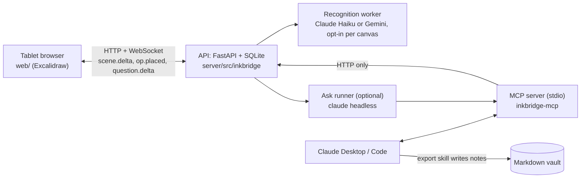

# Inkbridge

[](https://github.com/Srikar-V675/inkbridge/actions/workflows/ci.yml)
[](LICENSE)

**Your handwriting, readable by an AI agent, and traceable into your notes.**

Inkbridge is a handwritten canvas (Excalidraw in the browser, a pen on a tablet) wired into a markdown vault
and into any MCP agent. You think on paper-like ink. The server groups the strokes into **chunks**, one idea
each, and reads them. An agent such as Claude can read the whole canvas, answer questions about *your page*,
write a vault note whose sections point back to the exact ink they came from, and tell you when you later
change the ink so that a section is out of date. When the agent wants to add something to the canvas it draws
it as a **draft** that you accept or reject; it never edits or deletes your ink.

**Status (13 Nov 2026): feature freeze.** Everything described here is built, merged and tested (about 1,500
server tests, web logic tests, CI green). What is not done yet is listed honestly in [Status and limits](#status-and-limits).

- [Why this exists](#why-this-exists)
- [The idea](#the-idea)
- [What you can do](#what-you-can-do)
- [How it works](#how-it-works)
- [How it got here](#how-it-got-here)
- [Status and limits](#status-and-limits)
- [Future scope](#future-scope)
- [Setup](#setup) · [Develop](#develop) · [Layout](#layout) · [Docs map](#docs-map) · [Privacy](#privacy)

## Why this exists

I (Srikar) study and prepare for a masters application with handwritten notes: equations, diagrams, arrows,
half-sentences. I also keep a typed, linked Obsidian vault (a flat Zettelkasten with strict rules) and I use
Claude every day. Those three never met:

- Handwriting lives in a drawing app. A model cannot read it, search it, or answer from it, and nothing links
  it to the vault.
- Copying it into the vault by hand is the chore that kills note-taking habits. And once copied, the typed
  note and the page drift apart without anyone noticing.
- A chat with an AI starts from nothing. It does not know what is on *my page*, so it explains topics I never
  asked about, in a voice that is not mine.

The motivation was to keep writing the way I think, and let the AI come to the page instead of me going to
the AI. It is also my end-to-end AI project for the application profile: something innovative, on GitHub,
used daily, with claims I can test instead of assert.

## The idea

Four ideas carry the project. Everything else is plumbing.

1. **The strokes are the truth.** Ink is stored as vector strokes (with pen pressure), never as a screenshot.
   Everything else (readings, chunks, notes, answers) is derived from it and can be rebuilt.
2. **Chunks are addressable ideas.** The server clusters strokes into chunks with stable ids, so an agent can
   point at "this idea" and a note can remember which chunk a section came from. Arrows between chunks are
   links, so a diagram is a graph rather than a picture.
3. **Provenance with an early cutoff.** Three hashes do three jobs: `stroke_hash` (exact ink, drives
   crop staleness), `content_hash` (the *shape* of the ink, ignoring ids and where it sits on the page; keys the
   recognition cache and later note provenance), `text_hash` (the normalised reading). Moving a chunk or
   redrawing identical ink is not a change. A note section is flagged stale only when the *reading* changes, so
   you rewrite what you actually changed and nothing else. This is the distinctive claim.
4. **The agent is a guest with manners.** The agent reads through MCP, knows it is looking at a handwritten
   page ([decision 0122](docs/decisions/0122-agent-knows-it-is-in-a-canvas.md)), and writes back only as
   drafts you accept or reject. The backend never writes your vault either: a Claude skill does that, under the
   agent's own file access, and leaves every word outside its marker blocks alone.

## What you can do

| You do | What happens |
|---|---|
| Write with the pen on the tablet | Ink autosaves per element, merges across devices, and is grouped into chunks with stable ids. Pen samples reach the stroke at full rate over HTTPS. |
| Open `/` | A canvases home: Continue, Recent, All, Archived, search, rename, pin, duplicate, archive with Undo. |
| Ask a question about your page | The Ask panel answers from the canvas (and, labelled, from your vault), with source chips that jump to the chunks it used. Answers stream in. |
| Tell an agent "read my canvas" | `read_canvas` returns the chunks in reading order with their readings, links and groups; `get_region` shows a chunk's ink; `retrieve` searches across canvases. |
| Tell an agent "export this to my vault" | A note is written in your vault's own style: callout, frontmatter, one marker block per chunk, a folded crop, a deep link back to the ink. |
| Edit the ink later | `check_sync` flags only the sections whose reading changed; re-export rewrites those blocks and leaves what you edited by hand (it adds a conflict callout instead). |
| Draw a sketch | A two-pass reading finds boxes and arrows by geometry, then asks for Mermaid; the agent can redraw it cleanly as a draft and revise it later (`edit_diagram`). |
| Accept or reject a draft | One tap per draft, or all at once, with Undo. Accepted agent ink becomes its own chunk and is never sent to a reader. |

Offers (an agent proposing help beside your ink on its own) are built but **switched off by default**; see
[How it got here](#how-it-got-here) for why.

## How it works

Three processes, one owner of state.



**Ink in.** Strokes go to an IndexedDB device journal in 50 ms, an overlapping sender uploads them, and the API
merges per element (higher `version` wins; nothing is deleted by omission). Every save runs the chunker.

**Chunker.** Strokes are classified (writing, container, connector, arrowhead, underline, scribble), writing is
clustered by line-aware proximity, and arrows become links (short ones merge two chunks, long ones are rows in
`links`; a connector with a free end is a chunk of its own that is never read). Ids are kept stable by element-id
Jaccard matching, with `successor_of` on split and merge. A chunk too large to read is cut at its widest empty
gaps, and giant scribbles or frames leave first ([0124](docs/decisions/0124-split-oversized-chunks.md)).
Manual merge and split are pinned chunks.

**Reading.** Only the browser (or the server's Pillow raster) can render a chunk crop. A background worker reads
fresh crops once the canvas is idle, newest first, with a persistent Claude Haiku session (or Gemini). The
reading is cached by `(chunk, content_hash)`, so unchanged or merely moved ink never costs a call. For a
diagram the reader is handed the boxes and arrows the server found by geometry and writes them as relations,
`docs -has-> regions` ([0123](docs/decisions/0123-reader-gets-diagram-structure.md)).

**Agents.** The MCP server is a thin HTTP client of the API (a boundary test forbids it from importing the
database). Tools: `read_canvas`, `get_region`, `search`, `retrieve`, `check_sync`, `what_changed`,
`set_canvas_brief`, `get_subgraph`, `canvas_components`, `write_text`, `draw_diagram`, `edit_diagram`,
`get_markup`, `list_regions`, `create_canvas`, `list_questions`, `answer_question`, `list_tasks`, `claim_task`,
`complete_task`. See [docs/mcp-tools.md](docs/mcp-tools.md).

**Write-back.** An agent tool creates an op; the browser measures the drawn draft, the server places it
(searching for a free spot, sized from your handwriting), and the client draws it dashed from its own draft
store. Drafts live in the op row, not in the scene, so they are never chunked, read or exported until you
accept. Accept is one server transaction.

**Vault.** The `inkbridge-export` skill writes a note with one marker-bounded block per chunk and stores each
chunk's hashes in the frontmatter. It follows the vault's own rules and learns from the edits you make by
hand ([0125](docs/decisions/0125-export-skill-vault-style.md), [0103](docs/decisions/0103-skill-learning-loop.md)).
Format: [docs/vault-note-format.md](docs/vault-note-format.md).

Design records: [spec v3](https://claude.ai/artifact/FkyFV1UySxqfC9oFEYb1P1),
[technical reference v3](https://claude.ai/artifact/1uMmVHEyuvb2uS5Dgutaqy),
[spec v4](https://claude.ai/artifact/TJdewTbXM4JPFpDceL8U5Q),
[technical reference v4](https://claude.ai/artifact/GZDXFwCSeXwGZJBHtuuTJd), and 125 numbered notes in
[docs/decisions/](docs/decisions/).

## How it got here

The project went through four design rounds in about four weeks, and a final fortnight of testing on a real
tablet. The turns matter more than the feature list.

- **v1 (mid Oct): regions and MCP.** You boxed a region by hand and an agent read it. Honest result: nobody
  boxes things while they think. It was replaced by automatic chunks ([0004](docs/decisions/0004-chunks-replace-manual-regions.md)).
- **v2 and v3 (21 to 27 Oct): the vault loop.** Chunks, three hashes, the recognition cache, `check_sync`
  with early cutoff, the export skill, the ops queue and drafts, the Ask runner. This is the core claim and it
  has not changed since. Decisions made here that held: no Obsidian plugin (a plugin and a synced vault would
  fight over state; the backend is the single owner), drafts only add, the backend never writes the vault.
- **v4 (5 to 9 Nov): daily-use wave.** A tablet test produced a blunt verdict: "bare bones, I'm babysitting it".
  The response was a real app shell (design system, canvases home, tool rail), a per-element data model with live
  sync between devices, a device journal so ink never waits on the network, drafts moved out of the scene,
  streaming answers, diagram objects with versions, and mark-up as an instruction. The research behind it is in
  [docs/v4-research/](docs/v4-research/).
- **Offers (8 to 12 Nov): built, tuned, switched off.** The idea: the agent notices a question, an open
  equation or a dangling arrow and offers help beside the ink, as quickly as [Penecho](https://github.com/penecho/penecho)
  does. I built it three ways (rule detectors, a latest-ink read with a small model, an attention gate and
  budget), and on the tablet the noise and delay never reached "feels intelligent". The latency was mostly the
  Wi-Fi link plus a model call, and the cost of a cold agent per answer. A cheaper, quieter version needs a local
  model, which is future work. The code stays and is off by default
  ([0121](docs/decisions/0121-offers-off-by-default.md)); the project does not depend on it.
- **Chunking (10 to 13 Nov): deterministic beats clever.** I tried model-based page grouping. Sonnet grouped a
  page well (about $0.06 and 39 s per page) but was too expensive to run live; Haiku grouping was poor. What
  worked was a deterministic stroke-kind classifier with rules (arrows are long smooth strokes; slanted writing
  is levelled by its principal axis; scribbles join the writing) and a size-aware split, with the model used
  only to read. Related work that shaped this: Microsoft's ink analysis (writing versus drawing, hierarchy),
  cascades of writing and drawing detectors, set-of-marks prompting.
- **Reader (Nov): free tier to Haiku.** Gemini's free tier trains on content, so it is reserved for test and eval
  pages; real notes are read by Claude Haiku through one persistent session on the subscription.

## Status and limits

Built, merged, tested (CI green): everything in [What you can do](#what-you-can-do) except where noted below.

What is **not** verified or not done, stated plainly:

- **Tablet and real-page checks are the owner's and are pending** for most of the v4 wave (pen feel, lag, the
  UI on the tablet). The perf harness (`npm run perf`) found the app equal to stock Excalidraw; the remaining
  pen lag is the browser's one point per frame.
- **No real-page evals yet.** The harness exists (`eval/`, E1 input representation, E4 staleness, E5 chunking)
  and runs on synthetic fixtures only. Chunker thresholds are fitted to a handful of pages, so a very different
  hand or zoom may chunk badly; chunks can be merged and split by hand.
- **Diagrams are the weakest read.** A box-and-arrow sketch comes back as labels plus relations the reader
  derived from a geometric hint. Arrows that miss their boxes are guessed or dropped.
- **Speed depends on the network.** Saves, reads and answers over a weak Wi-Fi link are slow (a 2.4 GHz tablet
  saw 20 to 70 s saves). The answer runner starts a fresh `claude -p` per question (15 to 40 s).
- **The demo video, README screenshots and the evals are not part of this freeze.**
- Not built: deleting ink by a cross-out gesture, a PWA/install, multi-user, an Obsidian-native view.

## Future scope

Roughly in the order I would do them.

1. **Measure it.** Run E1, E4 and E5 on 12 to 15 real pages and report the numbers either way; calibrate the
   chunker and stroke-kind thresholds from them.
2. **Structure-aware reading.** Today a diagram's relations are one line of reader text. Next: per-box readings
   (numbered markers drawn on the crop, then one question per box) and a stored `structure` object, so an agent
   can query a diagram as a graph and an export can emit exact Mermaid.
3. **A fast, cheap, local reader** for the latest ink, so offers can come back without a cloud call per pen
   lift; an embedding ranker for `retrieve` (the hook `db.retrieve.RANKERS` is there); a small learned scorer for
   "offer this now?".
4. **A warm answer agent.** A persistent Haiku runner instead of a cold start per question.
5. **Closing the vault loop.** Atoms: propose and create `wiki/concepts` notes per chunk with links back; a
   weekly "what changed in my ink" digest; write-back from vault edits to canvas drafts.
6. **Gestures.** Cross-out to delete, circle-to-ask, lasso as a first-class selection.
7. **Install and sync.** A PWA with an offline outbox, and an authenticated mode for a hosted deployment.
8. **Collaboration**: shared canvases and per-reader chunk views are out of scope for now.

## Setup

You need Python 3.11+, [uv](https://docs.astral.sh/uv/), Node.js with npm, and optionally the
[Claude Code](https://claude.com/claude-code) CLI for the agent side.

```bash
git clone https://github.com/Srikar-V675/inkbridge && cd inkbridge
make install                      # uv sync (server) + npm install (web)
make serve                        # builds the web app, then API + app on :8000
```

Open `http://localhost:8000/` (canvases home) or `http://localhost:8000/?canvas=default` on the laptop.

**Tablet.** Use the laptop's LAN name or IP: `http://<laptop>.local:8000/?canvas=default`, and set
`INKBRIDGE_PUBLIC_URL=http://<laptop>.local:8000` so deep links in notes open there. One finger pans, two
pinch-zoom, the pen draws. For every pen sample the browser needs a secure context, so for the best pen feel
run `make serve-https` instead (port 4173; it makes a private CA in `data/tls/`, trust `data/tls/inkbridge-ca.crt`
on the tablet once). Use 5 GHz Wi-Fi on the same network as the laptop.

**Agents.** Register the MCP server once, then any Claude session can read and draw on your canvas:

```bash
claude mcp add --scope user inkbridge -- uv run --directory "$PWD/server" inkbridge-mcp
make install-skill                # link the export skill into ~/.claude/skills
```

For the HTTPS origin (`make serve-https`), register the server with the API URL and the CA:
`claude mcp add --scope user -e INKBRIDGE_API_URL=https://127.0.0.1:4173 -e SSL_CERT_FILE="$PWD/data/tls/inkbridge-ca.pem" inkbridge -- uv run --directory "$PWD/server" inkbridge-mcp`.

Set `INKBRIDGE_VAULT` to your vault folder and ask Claude to "export my inkbridge canvas to the vault".

**Settings** are plain environment variables; `.env.example` lists them, and `make serve` and `make serve-https`
load `.env` (the server itself does not read it). Optional features, all off until set:

| Feature | Setting |
|---|---|
| Reading your ink (search, Ask, export need it) | `INKBRIDGE_RECOGNIZE_DOCUMENTS=<canvas ids>` plus `INKBRIDGE_RECOGNIZER=claude` (Haiku, uses your Claude subscription) or `GEMINI_API_KEY` (test pages only, the free tier may train on them) |
| Ask answered automatically | `INKBRIDGE_RUNNER=claude` (see `.env.example`) |
| Offers beside your ink | `INKBRIDGE_OFFERS=1` (off by default) |
| Server-rendered crops | `INKBRIDGE_CROP_SOURCE=server` |

## Develop

```bash
make dev-server   # API on :8000 with reload
make dev-web      # Vite on :5173 (proxies the API)
make test         # server pytest + web tests
make lint         # ruff, oxlint, tsc
```

CI runs the same lint, test and build. One ticket per branch (`feat|fix|chore|docs/INK-xxx-slug`), a decision
note for anything non-obvious, and [CLAUDE.md](CLAUDE.md) as the contributor and agent guide.

## Layout

| Path | What |
|---|---|
| `web/` | Vite + React + Excalidraw frontend (app shell, home, sync, chunks, drafts, ask) |
| `server/` | Python package `inkbridge`: `api/`, `db/`, `canvas/` (pure scene logic, chunker), `agent/`, `recognizer/`, `mcp/` |
| `skills/` | The `inkbridge-export` skill and its helper |
| `eval/` | Evaluation harness and synthetic fixtures |
| `scripts/` | Serve helpers, TLS, snapshots |
| `docs/` | Everything in the docs map below |
| `data/` | Runtime state, gitignored |

## Docs map

| Read | For |
|---|---|
| [CLAUDE.md](CLAUDE.md) | Architecture, invariants, config, workflow; the guide for contributors and agents |
| [DESIGN.md](DESIGN.md) | The UI design system (tokens, rules, components) |
| [docs/mcp-tools.md](docs/mcp-tools.md) | Every MCP tool and its limits |
| [docs/vault-note-format.md](docs/vault-note-format.md) | The vault note and block format |
| [docs/decisions/](docs/decisions/) | Why each non-obvious choice was made, numbered 0001 to 0125 |
| [docs/codewiki/](docs/codewiki/overview.md) | Product-level wiki: flows, data model, API, env vars |
| [docs/deepdive/](docs/deepdive/README.md) | Code-level walkthrough with file references (a dated snapshot) |
| [docs/CHANGELOG.md](docs/CHANGELOG.md) | Version history from v1 to the freeze |
| [docs/v4-research/](docs/v4-research/) | The test-session report and research brief that shaped v4 |
| [docs/project-doc.html](docs/project-doc.html) | The v1 draft, kept as history |

## Privacy

Real notes stay out of the repo. Private snapshots of a real canvas (`scripts/snapshot_canvas.py`) go to
`~/.inkbridge-private/`, outside the repo and gitignored; CI never reads that folder. Gemini's free tier may train
on what it sees, so it only reads canvases you list; real notes are read by Claude. The committed real-scale
fixture is generated and synthetic (`eval/fixtures/make_real_scale.py`).

## Acknowledgements

[Excalidraw](https://excalidraw.com) for the canvas, [Penecho](https://github.com/penecho/penecho) for the
"agent beside your ink" idea and its latency discipline, Microsoft's ink analysis work for the writing and
drawing split, and the Model Context Protocol for making the agent side a small, boring interface.

## License

[MIT](LICENSE)
