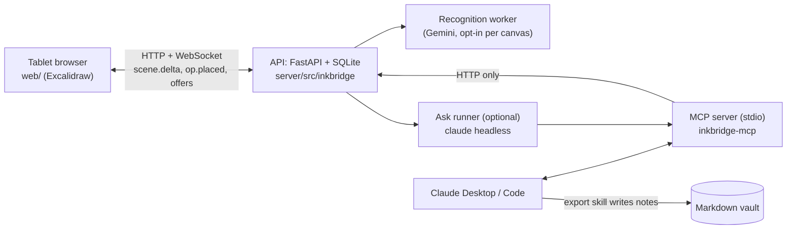

# Inkbridge

[](https://github.com/Srikar-V675/inkbridge/actions/workflows/ci.yml)
[](LICENSE)

**Status:** v4 built, tablet and real-page checks pending (see [CLAUDE.md](CLAUDE.md) "Current state").

A handwritten canvas wired into your markdown vault. You write with a pen in the browser (Excalidraw);
the server groups the ink into chunks; any MCP agent reads the whole canvas, writes a vault note whose
sections trace back to the ink (flagged stale only when what you wrote changes), answers your questions,
and draws diagrams and text back as drafts you accept or reject. Design: [Project spec v4](https://claude.ai/artifact/TJdewTbXM4JPFpDceL8U5Q)
and [Technical reference v4](https://claude.ai/artifact/GZDXFwCSeXwGZJBHtuuTJd); the v1 draft is kept in
[docs/project-doc.html](docs/project-doc.html). Contributor and AI guidance: [CLAUDE.md](CLAUDE.md),
[docs/mcp-tools.md](docs/mcp-tools.md), [docs/decisions/](docs/decisions/).

## Architecture

Three processes, one owner of state. The API owns scenes, chunks, drafts, questions and tasks; the MCP
server is a thin HTTP client; the vault is written only by the export skill, under the agent's own file access.



Ink flows browser -> device journal -> API (per-element merge, chunker) -> chunks. Agent output flows the
other way as drafts held in the op queue until you Accept, which writes them into the scene in one transaction.

## Setup

You need Python 3.11+, [uv](https://docs.astral.sh/uv/), Node.js with npm, and optionally the
[Claude Code](https://claude.com/claude-code) CLI for the agent side.

```bash
git clone https://github.com/Srikar-V675/inkbridge && cd inkbridge
make install                      # uv sync (server) + npm install (web)
make serve                        # builds the web app, then API + app on :8000
```

Open `http://localhost:8000/` (canvases home) or `http://localhost:8000/?canvas=default` on the laptop.

**Tablet.** Use the laptop's LAN name or IP: `http://<laptop>.local:8000/?canvas=default`, and set
`INKBRIDGE_PUBLIC_URL=http://<laptop>.local:8000` so deep links in notes open there. One finger pans, two
pinch-zoom, the pen draws. For every pen sample the browser needs a secure context, so for the best pen feel
run `make serve-https` instead (port 4173; it makes a private CA in `data/tls/`, trust `data/tls/inkbridge-ca.crt`
on the tablet once).

**Agents.** Register the MCP server once, then any Claude session can read and draw on your canvas:

```bash
claude mcp add --scope user inkbridge -- uv run --directory "$PWD/server" inkbridge-mcp
make install-skill                # link the export skill into ~/.claude/skills
```

Set `INKBRIDGE_VAULT` to your vault folder and ask Claude to "export my inkbridge canvas to the vault".
Tools are listed in [docs/mcp-tools.md](docs/mcp-tools.md); the note format in [docs/vault-note-format.md](docs/vault-note-format.md).

Settings are plain environment variables (the server does not read `.env`; `.env.example` lists them, so
`set -a; . ./.env; set +a` before `make serve`). Optional features, all off until set: handwriting recognition (`GEMINI_API_KEY` plus
`INKBRIDGE_RECOGNIZE_DOCUMENTS=<canvas ids>`; test pages only, the free tier may train on them), the Ask runner
(`INKBRIDGE_RUNNER=claude`, see `.env.example`), and offers beside your ink (`INKBRIDGE_QUIET_S`).

## Develop

```bash
make dev-server   # API on :8000 with reload
make dev-web      # Vite on :5173 (proxies the API)
make test         # server pytest + web tests
make lint         # ruff, oxlint, tsc
```

## Layout

| Path | What |
|---|---|
| `web/` | Vite + React + Excalidraw frontend |
| `server/` | Python package `inkbridge`: `api/` (FastAPI), `db/`, `recognizer/`, `mcp/` |
| `eval/` | Evaluation set, questions, scripts, results |
| `docs/` | MCP tool reference, vault note format, decision notes, v1 project doc |
| `skills/` | The `inkbridge-export` skill |
| `data/` | Runtime state, gitignored |

## Privacy

Real notes stay out of the repo and out of any model. Private snapshots of a real canvas
(`scripts/snapshot_canvas.py`) go to `~/.inkbridge-private/`, which is outside the repo and gitignored;
CI never reads that folder, nothing in it is committed, and it is never sent to Gemini or listed in
`INKBRIDGE_RECOGNIZE_DOCUMENTS`. The committed real-scale fixture is generated and synthetic
(`eval/fixtures/make_real_scale.py`, INK-095).

## License

[MIT](LICENSE)
