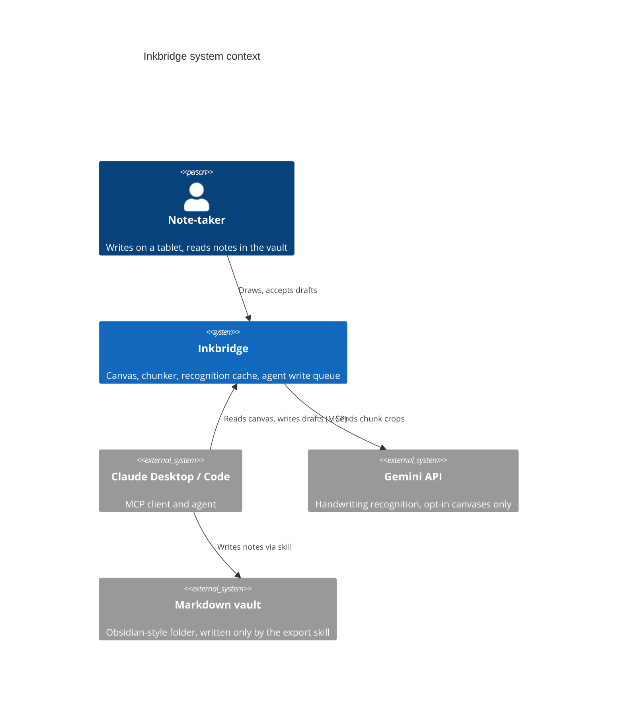
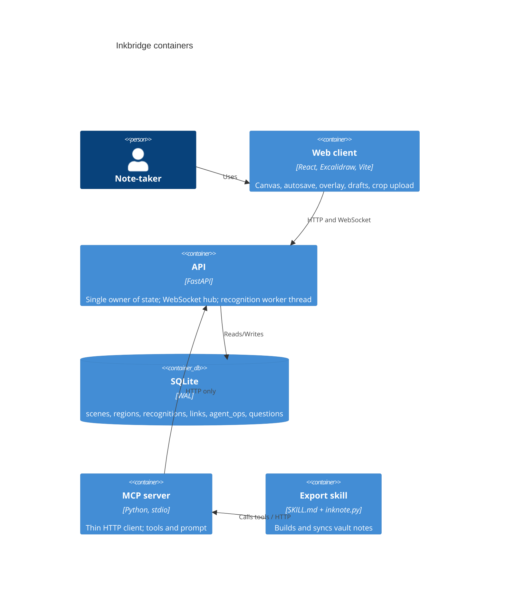
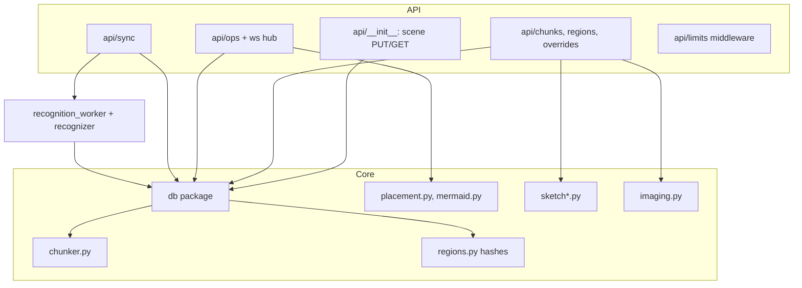

# Architecture Overview

## System context (C4 level 1)

## Containers (C4 level 2)

**The API is the single owner of scenes, regions, recognitions and the agent write queue.** The MCP server must never import `inkbridge.db` (boundary test). The backend never writes the vault. Run one API process (each starts a recognition worker).

## Components (C4 level 3), server

Dependencies are one-directional: `chunker.py`, `regions.py`, `placement.py`, `mermaid.py`, `sketch*.py` and `imaging.py` are pure (no I/O); `db/` imports `chunker` and `regions`; `api/` imports `db`; the worker imports `db` and the recognizer; `mcp/` imports only `config`, `sketch_prompts` and its own client.

## Architectural patterns

- **Single owner of state** with thin adapters (MCP, skill) over HTTP.
- **Derived state recomputed in the write transaction**: a scene save re-derives regions, chunks, ids, hashes and links under one `BEGIN IMMEDIATE`; any error rolls the whole save back.
- **Content-addressed cache** (recognition keyed by content hash) with **early cutoff** (text hash) for staleness.
- **Pure core, impure shell**: algorithms (chunker, sketch, placement, hashes) have no I/O and are unit-tested directly.
- **Optimistic concurrency**: scene `base_version`, crop `scene_version`, compare-and-set `mark_png_fresh`.
- **Idempotent, replayable event delivery**: ops are keyed by `op_id`, replayed on WebSocket connect, element ids carry an op prefix.
- **Invariant enforced server-side, not in the client** (agents never edit user ink).

## Key design decisions

1. **Chunks replace manual regions** (0004). Rationale: the user should not box ink by hand; trade-off: a heuristic grouping, with manual merge/split as pins (0024).
2. **Three hashes** (0005). `stroke_hash` drives crop staleness; `content_hash` (position-independent) keys recognition and provenance; `text_hash` gives early cutoff. Trade-off: more columns and a re-keying migration for integral floats.
3. **Stable chunk identity by element-id Jaccard** (0011) with orphan/successor links. Trade-off: small chunks lose ids; `check_sync` reports `replaced` as the safety net.
4. **Arrows: short ones merge, long ones link** (0013).
5. **Recognition is opt-in and background** (0006, 0017) because the Gemini free tier trains on content.
6. **Crops rendered only in the browser** and uploaded with a version handshake (0015).
7. **Agent output is draft ops** pushed by WebSocket (0009, 0012); Mermaid converts in the browser so `draw_diagram` waits for an ack and expires (0023).
8. **Vault is written only by a skill** with marker blocks so user text is never touched (0021).
9. **Vendor-neutral Ask AI**: pull path via MCP, optional runner (planned, 0007 reserved).
10. **Fixed limits**: 128 MiB scene body, 50,000 elements, 10 MB crops, 200 open ops, 500 canvases, 60,000-character `read_canvas` outline (0010, 0018).

## Module breakdown

| Module | Purpose | Deep dive |
|---|---|---|
| `chunker.py` | Cluster, arrows, pins, reading order, id matching | [chunker](4.%20Deep%20Dive/chunker.md) |
| `db/`, `regions.py` | SQLite layer, migrations, hashes, search | [database](4.%20Deep%20Dive/database.md) |
| `recognizer/`, `recognition_worker.py` | Gemini reading and background worker | [recognition](4.%20Deep%20Dive/recognition.md) |
| `api/sync.py`, `db/sync.py`, `db/outline.py` | `check_sync` and chunk outline | [check-sync](4.%20Deep%20Dive/check-sync.md) |
| `db/ops.py`, `api/ops.py`, `api/ws.py`, `placement.py`, `mermaid.py` | Agent write queue and push | [ops-queue-and-websocket](4.%20Deep%20Dive/ops-queue-and-websocket.md) |
| `api/__init__.py`, `api/regions.py`, `api/chunks.py`, `api/limits.py`, `imaging.py` | HTTP surface and image limits | [api-routes-and-limits](4.%20Deep%20Dive/api-routes-and-limits.md) |
| `sketch*.py` | Two-pass sketch reading | [sketch-to-diagram](4.%20Deep%20Dive/sketch-to-diagram.md) |
| `mcp/` | MCP tools and client | [mcp-server](4.%20Deep%20Dive/mcp-server.md) |
| `skills/inkbridge-export/` | Vault notes | [export-skill-and-vault-note](4.%20Deep%20Dive/export-skill-and-vault-note.md) |
| `web/src/App.tsx` | App shell | [web-app-shell](4.%20Deep%20Dive/web-app-shell.md) |
| `sceneSync.ts` | Load, autosave, conflict merge | [web-scene-sync](4.%20Deep%20Dive/web-scene-sync.md) |
| `cropSync.ts` | Crop upload | [web-crop-sync](4.%20Deep%20Dive/web-crop-sync.md) |
| `chunks.ts`, `ChunkOverlay.tsx`, `overrides.ts` | Deep link, overlay, merge/split | [web-chunks-overlay-overrides](4.%20Deep%20Dive/web-chunks-overlay-overrides.md) |
| `opsSocket.ts`, `drafts.ts`, `drawOp.ts` | Draft rendering | [web-ops-and-drafts](4.%20Deep%20Dive/web-ops-and-drafts.md) |

## Security and privacy posture

No authentication: a trusted LAN deployment. WebSocket origin check (4403 on mismatch). Request body caps before parsing. Gemini receives only canvases listed in `INKBRIDGE_RECOGNIZE_DOCUMENTS`; the key never appears in logs or reprs. LAN HTTP is not a secure context, so no feature may require one.
