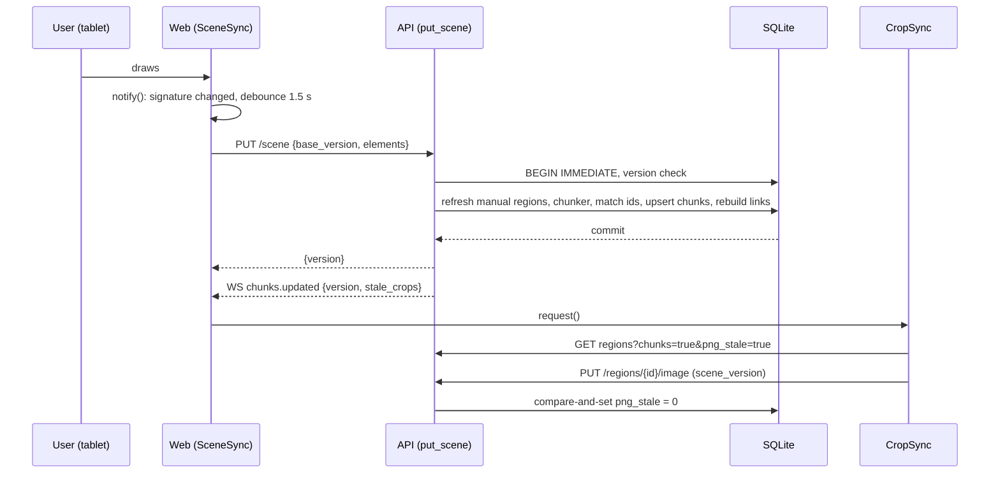
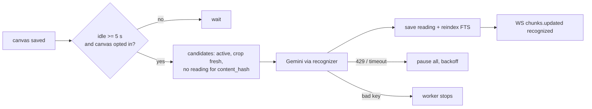
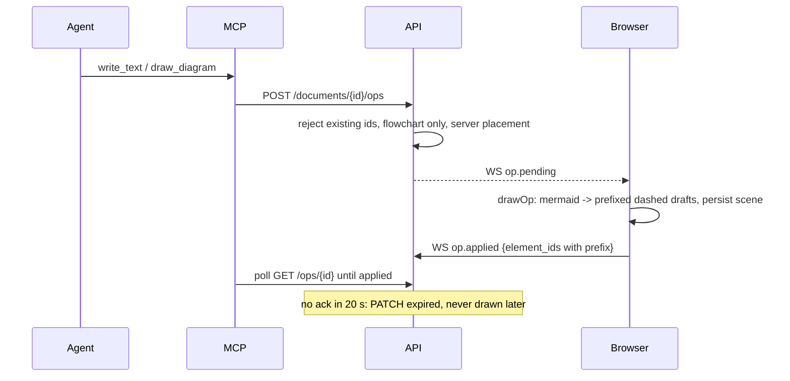
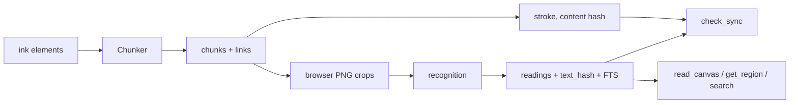

# Workflow Overview

## 1. Draw, autosave, chunk



Steps: the browser sends the whole scene; the server stores it, re-runs the chunker in the same transaction (unchanged chunks are skipped without hashing), flags chunks whose `stroke_hash` changed as `png_stale`, and announces it. The browser exports and uploads crops only when idle and saved. A 409 on the scene PUT makes the browser reload, merge by element version and retry; a 409 on a crop upload means this tab is behind. Details: [web-scene-sync](4.%20Deep%20Dive/web-scene-sync.md), [database](4.%20Deep%20Dive/database.md), [web-crop-sync](4.%20Deep%20Dive/web-crop-sync.md).

## 2. Recognition (opt-in, background)



Moved ink keeps its `content_hash`, so no new call is made. [recognition](4.%20Deep%20Dive/recognition.md).

## 3. Canvas to vault note and re-export

```mermaid
sequenceDiagram
  participant Ag as Agent + skill
  participant M as MCP server
  participant A as API
  participant H as inknote.py
  participant V as Vault
  Ag->>M: read_canvas
  M->>A: GET /documents/{id}/chunks, /overview
  Ag->>H: canvas, crops, new
  H->>V: note with marker blocks + attachments
  Note over Ag,V: later, after the user edits the canvas
  Ag->>H: sync NOTE
  H->>A: POST check_sync {id, hash, reading}
  A-->>H: fresh, fresh_after_reread, changed, replaced, removed, new
  Ag->>H: plan, then apply with new words only for needs_body
  H->>V: rewrite only changed blocks; refresh hashes; flag removed
```

Early cutoff: a redrawn but identically read chunk is `fresh_after_reread` and its words are not rewritten. [check-sync](4.%20Deep%20Dive/check-sync.md), [export-skill-and-vault-note](4.%20Deep%20Dive/export-skill-and-vault-note.md).

## 4. Agent draws back (draft ops)



Drafts are normal scene elements tagged `customData {author:"agent", draft:true, op_id}` and are ignored by chunking, recognition and export until accepted. [ops-queue-and-websocket](4.%20Deep%20Dive/ops-queue-and-websocket.md), [web-ops-and-drafts](4.%20Deep%20Dive/web-ops-and-drafts.md).

## 5. Sketch to diagram

`get_region(include_sketch=true)` returns the server's node/arrow guess and a numbered marker image; the agent corrects it, writes Mermaid citing the markers, and calls `draw_diagram` anchored beside the sketch. [sketch-to-diagram](4.%20Deep%20Dive/sketch-to-diagram.md).

## 6. Manual merge or split

Select ink, press Merge or Split in the overlay; the browser POSTs to `/chunks/merge|split`; the server inserts pinned chunks, re-runs the chunker so the matcher keeps their ids and orphans the originals with `successor_of`; notes migrate via `check_sync` `replaced`.

## 7. Deep link

`/?canvas=&chunk=` resolves the chunk, following `successor_of` up to 10 hops, then selects and fits it (or opens at an orphan's old bounds with a "Source changed" banner).

## Data flow



## State management

- Server: SQLite is the only durable state (scene versions, region status, readings, links, ops). The worker keeps in-memory backoff and urgent sets.
- Browser: Excalidraw scene (in memory), `SceneSync` pending/saved signatures, per-device view in `localStorage`, conflict backup in `localStorage`.
- Vault notes carry their own provenance in frontmatter; the backend stores no note text.

## Error handling

- **Save**: 409 merge-and-retry, 4xx stop until next edit, 5xx/offline backoff 2 to 30 s; the ink stays in memory.
- **Scene body**: 413 before parsing; malformed geometry or NaN is a 422 so one bad element cannot wedge autosave.
- **Recognition**: backoff per (region, hash); 429 or timeout pauses the worker; an invalid key stops it; none of it reaches the editor.
- **Ops**: invalid transitions are 409; bad acks are refused with `op.error`; failed or expired ops have their drafts swept.
- **MCP**: every failure becomes a `ToolError` with a next step; a missing crop yields a text note instead of a failure.
- **Vault**: the helper refuses CRLF, validates before and after, writes atomically, and aborts without changes if one block would be touched twice.
