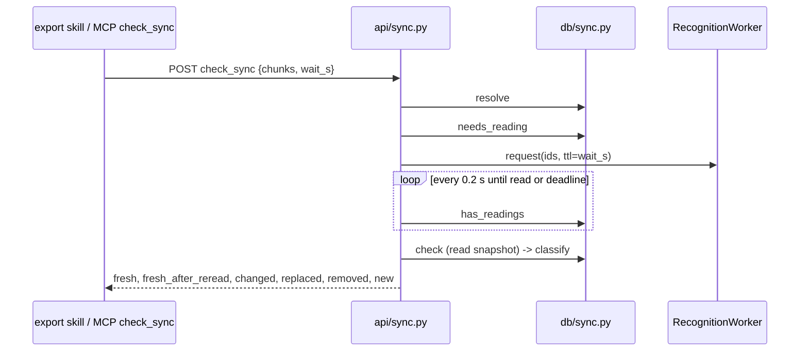

# Deep Dive: check_sync and the chunk outline (`api/sync.py`, `db/sync.py`, `db/outline.py`)

`check_sync` answers "which blocks of my vault note are stale?" using hashes the note carries. It reads only; the single thing it can set in motion is the recognition worker, which writes into the recognition cache (decision 0020).

## Request (`api/sync.py`)

`POST /documents/{id}/check_sync` with `{chunks: [{id, hash, reading?}], wait_s}`:
- `hash` is the chunk's `content_hash` when the note was written; `reading` is its `text_hash` then (null if it had none). Both 1 to 128 characters.
- At most `MAX_CHUNKS = 2000`; `wait_s` in `[0, 30]`, default 15.

Flow (`:34-58`):
1. `sync.resolve` in the threadpool; unknown document gives 404.
2. `sync.needs_reading` lists live chunks that need a reading and can have one now.
3. If any, `wait_s > 0` and a worker exists on `app.state.recognition_worker`: `worker.request(document_id, missing, ttl_s=wait_s)` returns the ids it accepted; the handler polls every `POLL_S = 0.2` s with `asyncio.sleep` (no threadpool thread is held while waiting), checking `sync.has_readings`, until all are read or the deadline passes.
4. Finally `sync.check` classifies on one read snapshot.

## Resolution (`db/sync.py`)

`resolve` (`:34-54`) maps each distinct note id (first occurrence wins) to `(note, region, successor)`:
- unknown id, or a chunk of another document -> `(note, None, None)` (removed);
- active chunk -> `(note, region, None)`;
- orphaned chunk -> `(note, None, successor)` where `_live_successor` follows `successor_of` up to `MAX_HOPS = 64` and returns the first active region, or `None` on a dead end, a cycle, or a region of another document (`:17-31`).

`needs_reading` (`:57-67`): for each note whose region has a different `content_hash` than the note (or whose chunk was replaced), if that live chunk has no reading (`source` empty) **and** a fresh crop (`png_stale` false), it is listed. A stale crop cannot be read until the browser re-exports it, so waiting would only burn the whole wait; it is reported at once instead.

`check` (`:75-81`) opens `BEGIN` (a WAL read snapshot from the first SELECT) so a save between `resolve` and `classify` cannot mix two scenes, then rolls back.

## Classification (`classify`, `:84-135`)

| Result | Rule |
|---|---|
| `fresh` | Active, `content_hash` equals the note's hash, and either there is no reading or its `text_hash` equals the note's `reading` |
| `changed` | Same ink but a reading exists that the note lacks or differs on (exported before recognition, or a user/agent corrected it); or a different ink whose reading differs, or has none (`reading: null`) |
| `fresh_after_reread` | Different ink, but the reading's `text_hash` equals the note's `reading` (cosmetic edit; early cutoff) |
| `replaced` | Orphaned note chunk with a live successor: `{id, successor, hash, reading}`; several entries can share one successor (merge), so the skill rewrites that block once |
| `removed` | No region and no live successor |
| `new` | Active chunks not listed in the note and not a successor of a replaced chunk, with `{id, hash, reading, preview}` (text cut at 80 characters with `…`) |

"No reading is never a match" (`:107`): the code errs toward a visible update rather than a silent miss. Moves keep `content_hash`, so a moved chunk is `fresh`.

## Chunk outline (`db/outline.py`)

`chunk_outline(conn, document_id, status, png_stale)` is what `read_canvas`, `GET /documents/{id}/chunks` and `check_sync`'s `new` list read:
- loads the version and all auto chunks, plus outgoing `links`;
- `reading_order` (see [chunker.md](chunker.md)) is computed over **active** chunks only, giving a 1-based `order` before any filter, so a filtered list still says where each chunk sits; orphaned chunks have `order: None` and follow by id;
- each entry: `id, order, kind, bounds, element_ids, text, latex, source, status, successor_of, png_stale, content_hash, text_hash, links`.
Also: `create_document` (12-hex id, empty scene, cap `MAX_DOCUMENTS = 500` so an agent loop cannot fill the disk, raises `TooManyDocuments`), `list_documents` (newest first), `chunk_crops` (active chunks with bbox, crop path and stale flag for the overview image).

## Sequence

## Testing

`tests/test_check_sync.py` (about 35 tests: fresh/moved/nudged/changed, whitespace-only differences, removed and unknown ids, another canvas's chunk, split/merge replaced, successor chains and cycles, `new` in reading order, purity of the read, worker waiting, timeouts and the wait bound, canvases not opted in, stale crops not waited for, backoff, user corrections beating Gemini, and the MCP tool) and `tests/test_vault_export.py` (the skill's use of the result).

## Potential improvements

Decision 0020 documents the early-cutoff trade-off: a reading that changes only by whitespace stays `fresh_after_reread`. Chunks of other documents named in a note are reported `removed`, not an error.
