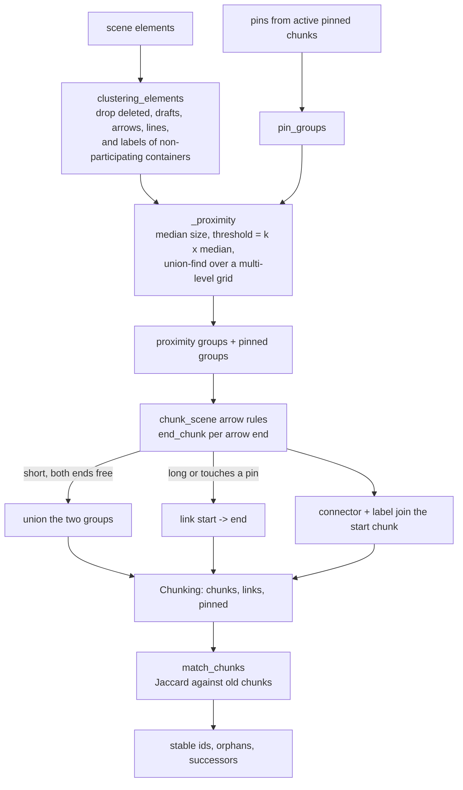

# Deep Dive: chunker (`server/src/inkbridge/chunker.py`)

Pure module: no I/O, no SQLite. Imports only `bbox_of` from `regions.py` (`chunker.py:16`). It runs inside every scene save (`db/__init__.py:493`, `_sync_chunks`) and turns Excalidraw elements into **chunks** (lists of element ids) plus **arrow links**, then keeps chunk ids stable across saves.

## Responsibilities

- Cluster live ink by proximity (`cluster` / `_proximity`).
- Apply the arrow rules: short arrows merge two chunks, long ones become links (`chunk_scene`).
- Honour manual overrides (pins, `pin_groups`).
- Order chunks for reading (`reading_order`), guess a kind (`kind_hint`).
- Match new clusters to old chunk ids (`match_chunks`).

## Pipeline

## Configuration (`ChunkerConfig`, `chunker.py:26-42`)

| Field | Default | Meaning |
|---|---|---|
| `k` | 1.5 | Merge when the gap between two boxes is below `k x median element size` |
| `arrow_merge` | 6.0 | An arrow whose path is at most this many medians long merges its two chunks |
| `link_reach` | 3.0 | A free arrow end links to a chunk within this many medians |
| `min_median` | 4.0 px | Floor for the median, so tiny dots cannot collapse the threshold |
| `match_threshold` | 0.5 | A cluster keeps an old id when element-id Jaccard is above this |

The dataclass is frozen and validates in `__post_init__`: the first four must be positive, `match_threshold` in `[0, 1)`. All constants live in one object so one config tunes the whole pipeline (`test_config_rejects_values_that_break_the_maths`, `test_chunker.py:501`). Decision 0022 kept these values after a synthetic sweep; real handwriting still needs checking.

## Who takes part (`clustering_elements`, `chunker.py:57-75`)

An element clusters by proximity only if it is not deleted, not a draft (`customData.draft`), and not an `arrow`/`line` (`_CONNECTORS`, `chunker.py:19`). Bound text follows its container: if the container is in the scene but does not take part (deleted, draft, or a connector), the text is dropped too, so a draft's label never becomes content (`test_label_of_a_draft_or_deleted_container_is_not_content`). If the `containerId` points at nothing, the text clusters by proximity like anything else (`test_dangling_container_id_clusters_by_proximity`).

## Proximity clustering (`_proximity`, `chunker.py:110-217`)

1. **Order and sizes.** Elements are sorted by id (so input order never matters, `test_result_is_independent_of_input_order`). Each element's size is `max(width, height)` of its box (`_box` uses `bbox_of`, which uses point extents for strokes). `median = max(median(sizes), min_median)`; `threshold = k x median` (lines 118-123).
2. **Pins excluded, but they still count in the median** (line 121-124), so pinning a group does not change how the rest clusters.
3. **Bound text** is unioned with its container directly, at any distance (lines 133-137, `test_bound_text_joins_its_container_regardless_of_distance`).
4. **Identical boxes** (overwritten strokes, stacked shapes) are unioned up front and only the first goes into the grid (lines 153-162, `test_identical_boxes_form_one_chunk_even_when_tiny`).
5. **Multi-level grid** (lines 139-176). Level-0 cells are `threshold / 2` wide. An element is indexed at the finest level where it covers at most `_MAX_CELLS = 64` cells; each further level has cells `_LEVEL_FACTOR = 8` times wider. Oversize elements therefore never fall back to comparing against everything.
6. **Free merge inside a level-0 cell** (lines 178-180): two boxes touching the same level-0 cell are at most `threshold / sqrt(2)` apart (the cell diagonal), so every member of a cell is unioned without measuring.
7. **Neighbour search** (lines 186-212): for each element, per level, the cells within `threshold` of its box are visited. A cell known to hold one group (`single`, lines 183-184) is skipped once its representative is in the same group. Otherwise members after `i` (via `bisect`) are tested with `_gap(a, b) < threshold`, where `_gap` is the Euclidean distance between boxes (0 when they overlap, `chunker.py:94-97`). When a cell becomes single-group it is recorded.
8. **Output** (line 214-217): ids grouped by union-find root, each group sorted, groups sorted by their smallest id; the median is returned too because the arrow step reuses it.

The union-find (`chunker.py:78-91`) uses path halving and always roots at the smaller index, which keeps results deterministic.

Complexity notes in the tests: 5,000 elements cluster in under a second, dense overlapping ink and mixed oversize elements stay fast, and the grid result equals a brute-force comparison (`test_grid_clustering_matches_brute_force_on_mixed_sizes`, `test_chunker.py:209`).

**Worked example.** Strokes of about 20 px: median 20, threshold 30. Two words 25 px apart merge into one chunk; a heading 45 px above the next line stays separate. If lines are 40 px apart with 20 px strokes (gap 20 < 30) they merge into one paragraph chunk, which decision 0022 accepts for notes but flags for re-checking on real pages.

Scaling the whole layout does not change the result (`test_scaling_the_layout_does_not_change_the_clustering`).

## Pins (`pin_groups`, `chunker.py:227-250`)

A pin is a set of element ids from a manual merge or split (INK-059, decision 0024). `pin_groups` reduces pins to ink that can cluster: ids that are deleted, drafts, connectors or unknown are dropped. A container and its bound text are one unit (keyed by the container id), so picking either picks both. Pins are made disjoint, earlier pins keeping a shared unit. Empty pins vanish. Pinned groups are appended after the proximity groups and nothing joins them by proximity.

## Arrow rules (`chunk_scene`, `chunker.py:267-385`)

Each live arrow/line gets two ends via `end_chunk(c, binding, point_index)` (lines 321-343):

1. **Bound end** (`startBinding`/`endBinding`): the chunk that owns the bound element. If that element is in no chunk (deleted or a draft) the end **dangles** (`None`), it does not fall through to geometry.
2. **Free end**: the end point is `x + points[i]` in canvas coordinates. A non-finite point dangles. Candidates come from a uniform grid of `reach`-wide cells (`reach = link_reach x median`), searching the 3 x 3 cells around the point, plus `large` boxes that span more than `_MAX_CELLS` cells. Among candidates the nearest box wins; ties between nested boxes go to the smaller area (`scored` tuple, line 336-340). Farther than `reach` means dangling.

Then (lines 345-358): an arrow with at least two points whose path length is at most `arrow_merge x median` and whose ends are both free and not in a pinned chunk (`max(start, end) < first_pinned`) merges the two groups (`uf.union`). Otherwise, if it is an arrow, it is recorded as a possible link. Lines (`type: line`) never merge or link. Short arrows merge transitively (`test_short_arrows_merge_transitively`).

Finally (lines 360-374): every connector and its bound label join the chunk of its **start**, else of its **end**; with neither it forms a chunk of its own (`extra`). A link `(find(start), find(end))` is added only if the two roots differ after merging, so arrows inside one chunk or into a merged chunk make no self-link.

Result (`Chunking`, lines 377-385): chunks sorted by smallest member id, `links` as sorted unique index pairs, and `pinned` flags (root index at or beyond `first_pinned`). The `links` direction follows the arrow (`test_link_direction_follows_the_arrow_and_duplicates_collapse`).

## Reading order and kind

- `reading_order(boxes)` (`chunker.py:399-419`): sort by `(y, x, id)`, then group into rows; a chunk joins the current row when its vertical centre is within `0.5 x median chunk height` of the row's mean centre. Rows read top to bottom, each left to right, so a slightly slanted left-to-right diagram reads left to right (`test_reading_order_row_tolerance_reads_a_slanted_diagram_left_to_right`).
- `kind_hint(elements)` (`chunker.py:422-431`): `handwriting` when no shapes, `diagram` when shapes and no `freedraw`/`text`, else `mixed`. A hint only, ignores drafts. The Gemini reading may later overwrite `kind` (`db/__init__.py:932-946`).

## Stable ids (`match_chunks`, `chunker.py:440-502`)

Inputs: every old auto chunk of the canvas (orphaned too, so undo can reactivate one), the new clusters, their top y values, the set of active old ids, the threshold, and an `ignore` set.

- **Core**: connectors and their labels (`connector_ids`, line 388) are removed before comparing, so drawing or deleting an arrow does not change a small chunk's id. A chunk made only of ignored ids is matched on all of them.
- **Candidates**: via an element-to-old-chunk index, count shared elements per (cluster, old chunk) and compute `J = inter / (|new| + |old| - inter)`. Pairs with `J > threshold` are kept.
- **Greedy one-to-one**: sort by `(-J, -overlap, orphaned-last, old id, cluster index)` and assign each pair if neither side is taken. So the highest Jaccard wins, a larger overlap breaks ties, and an active chunk beats an orphaned one.
- **Successors**: every active old chunk left unmatched is orphaned; its successor is the cluster sharing the most elements (ties: higher on the page, then lower index), or `None` if it shares nothing (a deleted chunk).

Consequences, all covered in `test_chunker.py:314-400`: adding a stroke keeps the id; a half-and-half split gives both pieces new ids with the higher piece as successor; an uneven split keeps the id on the big piece; a merge gives a new id and both old ids point at it; undo hands an orphaned chunk its id back. The known weakness is small chunks: two elements gaining three is J = 0.4 and gets a new id. The safety net is `check_sync`, which reports `replaced` with the successor.

## How `db/__init__.py` uses it

`_sync_chunks` (`db/__init__.py:463-556`) feeds pins from active pinned chunk rows, calls `chunk_scene`, computes bounding boxes, calls `match_chunks(... ignore=connector_ids(elements))`, creates uuid ids for unmatched clusters, then upserts. See [database.md](database.md).

## Testing

`server/tests/test_chunker.py` (pure unit tests, including a brute-force comparison and speed checks), `test_chunk_pins.py`, `test_links.py` and `test_chunk_persistence.py` (database level, including a 2,000-element scene and rollback).

## Potential improvements

- Small-chunk identity: Jaccard loses ids for chunks of one or two strokes. Decision 0022 considers a 60% containment test but rejects it for now because merge/split would be ambiguous.
- `k` has not been tuned on real handwriting (decision 0022); line spacing under 1.5 median merges paragraphs.
- Rows in `reading_order` use a mean centre, so a very tall chunk can pull neighbours into its row.
