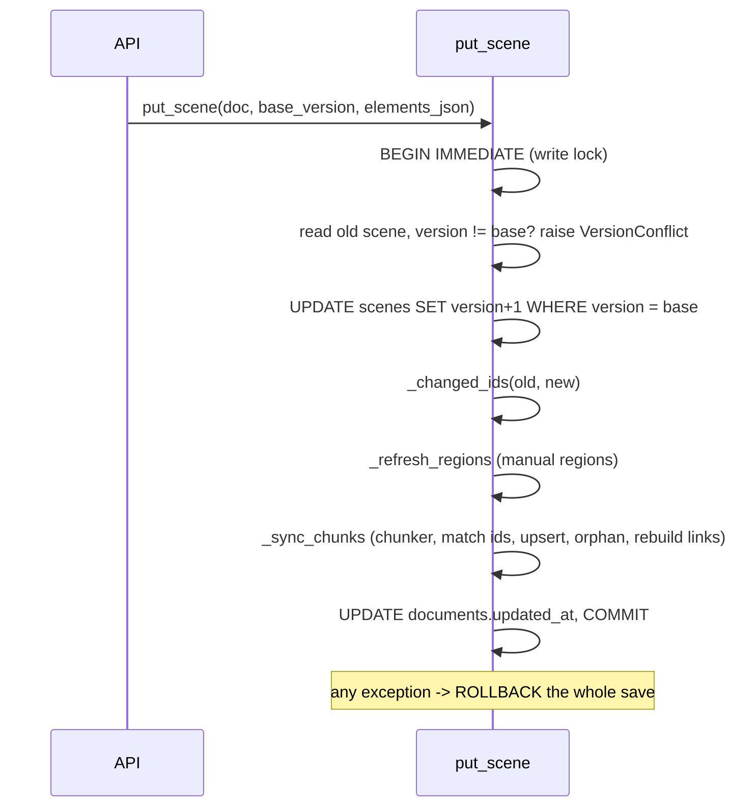
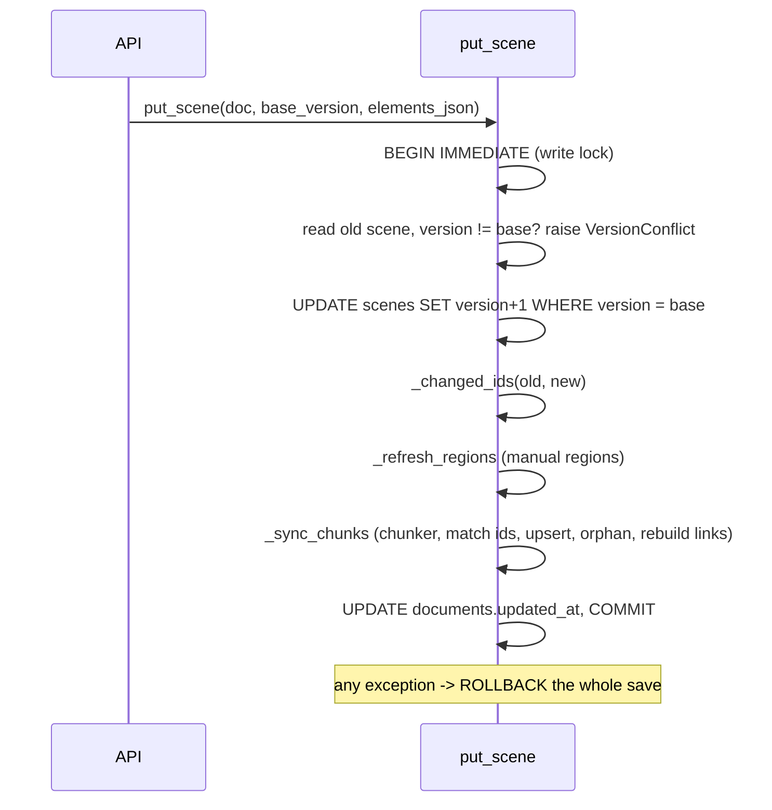

# Deep Dive: database layer (`server/src/inkbridge/db/` and `canvas/hashes.py`)

> Snapshot written 26 Oct 2026; sections marked Updated 13 Nov 2026 were refreshed.

`db/__init__.py` (about 1,000 lines; splitting it is INK-068, backlog) is the only module that touches SQLite; the MCP server must not import it (boundary test `test_mcp_boundary.py`). `canvas/hashes.py` holds the pure maths (bbox and the three hashes). `db/ops.py`, `db/sync.py` and `db/outline.py` are covered in their own pages.

## What changed since 26 Oct (Updated 13 Nov 2026)

`db/` is now a package with one module per table group (INK-068 landed; `db/__init__.py` is about 210 lines and re-exports): `common` (`connect`, `_now`), `migrations` (`migrate`), `documents`, `scenes` (`put_scene`, `merge_elements`), `elements` (per-element rows), `regions`, `chunks` (`_sync_chunks`, `merge_chunks`, `split_chunk`, `_gc_orphans`), `crops` (`mark_png_fresh`), `ink`, `recognitions`, `ops`, `drafts`, `diagrams`, `questions`, `tasks`, `offers`, `watch`, `memory`, `sync`, `outline`, `retrieve`, `supersede`. So the `db/__init__.py:NNN` references in the sections below point at the old single file; use the module names above. The MCP server still must not import `inkbridge.db`.

**Migrations 0001 to 0018** (forward-only, run on API start inside one `BEGIN IMMEDIATE`):

| # | File | What |
|---|---|---|
| 0001 | `0001_init` | documents, scenes, regions, recognitions, agent_ops |
| 0002 | `0002_region_png_stale` | `regions.png_stale` |
| 0003 | `0003_region_fts` | `region_fts` FTS5 |
| 0004 | `0004_v2` | `successor_of`, `content_hash`, recognitions rebuilt (`content_hash`, `text_hash`), `links`, `questions`, op columns |
| 0005 | `0005_chunk_pins` | `regions.pinned` |
| 0006 | `0006_question_runner_status` | `questions.runner_status`, `runner_error` |
| 0007 | `0007_canvas_home` | `documents.pinned`, `archived_at`, `last_opened_at`; `scenes.element_count`; indexes |
| 0008 | `0008_scene_elements` | `scene_elements` table, one row per element (one-way); `scenes.elements_json` retired but kept one release |
| 0009 | `0009_links_v2` | `links` rebuilt (kinds `arrow`, `near`, `answer`, `relates`, `derived`; `source`, `label`, `confidence`, `element_id`); `documents.chunker` |
| 0010 | `0010_answer_fts` | `answer_fts` FTS5 over answered questions |
| 0011 | `0011_drafts_in_ops` | `agent_ops` gains `elements_json`, `box_json`, `question_id`, `task_id`, `offer_id`, `revises`, `diagram_id`, `resolved_at` |
| 0012 | `0012_offers` | `offers` table, `documents.focus` |
| 0013 | `0013_watches` | `watches` |
| 0014 | `0014_canvas_memory` | `canvas_memory` (brief and `what_changed` cursor) |
| 0015 | `0015_question_canvas_text` | `questions.canvas_text` |
| 0016 | `0016_agent_tasks` | `agent_tasks`, backfilled from pending questions |
| 0017 | `0017_diagrams` | `diagrams` |
| 0018 | `0018_question_partial` | `questions.partial_answer`, `partial_seq` |

**Per-element scenes.** A scene is `scenes` (version, `element_count`) plus `scene_elements` rows (`pos`, `seq`, `version`, `nonce`, `is_deleted`, `json`). `db/elements.py` keeps the element JSON verbatim; `pos` fixes an element's slot in the array when the row is first inserted; `seq` is the scene version of the save that last wrote it. `merge_elements` merges per element: higher `version` wins, a tie goes to the lower `versionNonce`, nothing is deleted by omission. A deleted row keeps its JSON 14 days, then shrinks to a stub `{id, version, versionNonce, isDeleted}` (a tombstone, recognised by having no `type`). `GET /elements?since=N` reads rows by `seq`. The 409 `VersionConflict` path in the diagram below is the 26 Oct design: `PUT /scene` now runs the same merge with `strict=False` (decisions 0077, 0080).

**Other additions.** Orphaned auto chunks are collected on save (`_gc_orphans`: newest 40, at most 14 days, successor chains kept; decision 0048). The chunker is chosen per canvas (`_resolve_config`, v2 default). `db/retrieve.py` ranks over `region_fts` and `answer_fts` (`RANKERS`). `db/supersede.py` retires superseded agent chunks. `INKBRIDGE_DB` and `INKBRIDGE_DATA_DIR` are read at call time.

## Connection and migrations (26 Oct snapshot)

- `connect()` (`db/__init__.py:37-44`): `check_same_thread=False`, `Row` factory, `foreign_keys = ON`, WAL journal so readers do not block behind the scene writer.
- `migrate()` (`:51-73`): applies numbered `.sql` files from `db/migrations/` inside one `BEGIN IMMEDIATE`, which doubles as a cross-process lock (a second API process or worker waits up to `MIGRATE_LOCK_TIMEOUT_MS = 120_000`, then finds the versions recorded). A failure rolls everything back (decision 0010). `isolation_level` is switched to manual so the sqlite3 module cannot commit under it.
- `_apply_migration` runs statements one by one (`_statements` splits on `;` but keeps semicolons in strings and triggers via `sqlite3.complete_statement`), not `executescript`, because that would commit and drop the lock.
- After migration 0004, `_backfill_v2` fills `content_hash` on regions, re-keys current readings, adds `text_hash`, and rebuilds the FTS rows. It is triggered by "any region with NULL content_hash", so it also heals an interrupted backfill. `_rekey_integral_hashes` runs on every start and moves a region whose stored hash is the *legacy* form of its current ink to the new form (decision 0005: browser JSON gives `15`, a drag yields `15.0`).
- Migrations 0001 to 0005 were the 26 Oct set; the full list to 0018 is in the table above.

## Tables

| Table | Notes |
|---|---|
| `documents`, `scenes` | `scenes.version` is the optimistic lock |
| `regions` | Manual regions and auto chunks (`created_by='auto'`); `status` active/orphaned; `png_stale`; `successor_of`; `pinned` |
| `recognitions` | PK `(region_id, content_hash, source)` |
| `region_fts` | FTS5 (`text`, `latex`) holding the best reading for the current content hash |
| `links` | Arrow links between chunks, rebuilt on every save |
| `agent_ops`, `questions` | See the ops page; questions are served by [questions-api](questions-api.md) (`db/questions.py`) |

## Saving a scene (`put_scene`)

`put_scene` takes `delta=` and `max_elements=`; in delta mode it merges changed elements by id under the same lock ([scene-delta-saves](scene-delta-saves.md)). It logs phase timings under `inkbridge.scene`. Orphaned chunks are never deleted (decision 0028) and `successor_of` has no foreign key yet (decision 0027; guarded by `tests/integrity_check.py`).

Mermaid source

`_changed_ids` (`:271-280`) compares whole elements (added, removed or edited). Volatile-field churn counts as a change here but the hashes then come out equal and nothing is written.

### `_refresh_regions` (`:417-460`, manual regions)

Only regions holding a changed element are examined. New `stroke_hash`: flag `png_stale = 1`. New `content_hash`: the ink changed, so `_reindex_region` drops the old reading from search. Status becomes `orphaned` if every element is deleted. Written only when something differs, so unrelated edits leave `updated_at` alone. A pure move changes only `stroke_hash`, so the reading and search hit survive.

### `_sync_chunks` (`:463-556`)

1. Load all auto chunk rows; collect pins (active pinned rows).
2. `chunk_scene(...)`, boxes, `match_chunks(...)` (see [chunker.md](chunker.md)); unmatched clusters get `uuid4().hex[:12]`.
3. For each cluster: skip if same elements, still active, and none changed (`:513-515`); insert if new (`_insert_chunk`, `png_stale = 1`, crop path `crops_dir()/<id>.png`); skip if only volatile fields moved (`:521`); otherwise update elements, bbox, hashes, `status='active'`, `successor_of=NULL`, pin flag, and set `png_stale` when `stroke_hash` changed. `kind` is recomputed only if the content hash changed. A content change reindexes (drops the search row).
4. Orphan every unmatched old active chunk with its `successor_of` (`:544-549`) and clear its pin.
5. Delete and re-insert all `links` rows for the document.

Test coverage: `test_chunk_persistence.py` (ids, successors, undo reactivation, rollback on failure, two racing writers, 2,000-element performance, restart re-keying).

## Manual overrides (`merge_chunks`, `split_chunk`, `_override`, `:602-703`)

Under `BEGIN IMMEDIATE`, the new pinned chunks are inserted with exactly the pinned ink, then `_sync_chunks` is called with an empty `changed` set; the matcher keeps the new ids (Jaccard 1) and orphans the originals with `successor_of`. A guard raises `RuntimeError` if that did not happen. Errors: `ChunkNotFound`, `ChunkNotActive` (stale chunk list), `InvalidOverride` (fewer than two ids, connector-only chunks, selection not inside the chunk, nothing left behind). The scene is read, never written.

## Regions and readings

- `create_region` computes bbox and hashes from the stored scene, never the client; `created_by='auto'` is reserved (`ReservedCreator`).
- `_BEST_RECOGNITION` (`:294`): precedence `user` > `agent` > `gemini`, newest first. `_region_dict` joins the best reading at the region's current `content_hash`.
- `save_recognition` upserts and reindexes; `save_model_reading` also lets a Gemini reading set an auto chunk's `kind` if the hash still matches.
- `recognition_candidates` and `read_fresh_crop` feed the worker (see recognition page).
- `mark_png_fresh(region, scene_version)` is a compare-and-set on the scene version in one statement, so a crop of older ink is never marked fresh (INK-057).
- `list_regions(chunks=False)` selects manual or auto via `created_by IS NOT ?` / `IS ?`.
- `get_sketch_elements` returns a region's elements plus one hop of linked regions (limit 50) for sketch reading; `get_region_ink` returns raw strokes.

## Search

`_fts_query` turns free text into quoted prefix tokens (`"foo"* "bar"*`, ANDed). `search` joins `region_fts` to active regions, scores `-bm25` and snippets with `[ ]`.

## `canvas/hashes.py` (pure maths)

| Function | Purpose |
|---|---|
| `bbox_of` (`:33`) | Bounds of live elements; strokes use point extents (points are relative and may be negative), others x/y/width/height; rotation ignored |
| `stroke_hash` (`:23`) | SHA-256 of rows with `HASH_FIELDS` (id, type, x, y, width, height, angle, points, pressures, isDeleted), sorted by id |
| `content_hash` (`:88`) | Drops deleted; rows of `_CONTENT_FIELDS` plus `dx`,`dy` offsets from the bbox origin rounded to 0.001; integral floats become ints (`_integral`); sorted by `(round(dy), round(dx), canonical(row))` so order and ids do not matter |
| `legacy_content_hash` (`:99`) | Pre-INK-031 form, only for re-keying |
| `text_hash` (`:119`) | Normalised (`" ".join(s.split())`) text and latex |

Never hash `version`, `versionNonce`, `updated`, `seed` or `customData`.

## Potential improvements

INK-068 is done (package split). Still open: INK-070 (SQLAlchemy vs raw sqlite3) and INK-071 (Alembic vs the hand-rolled runner).
