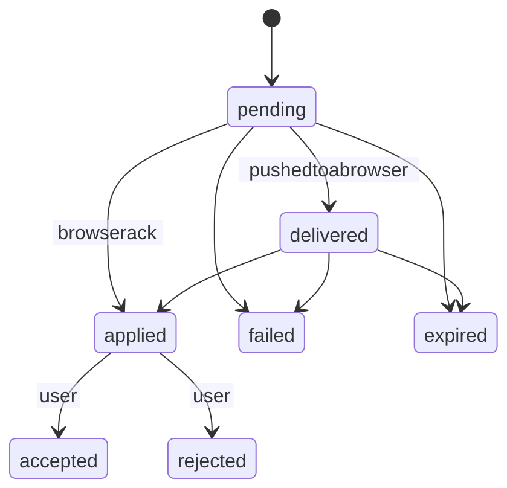
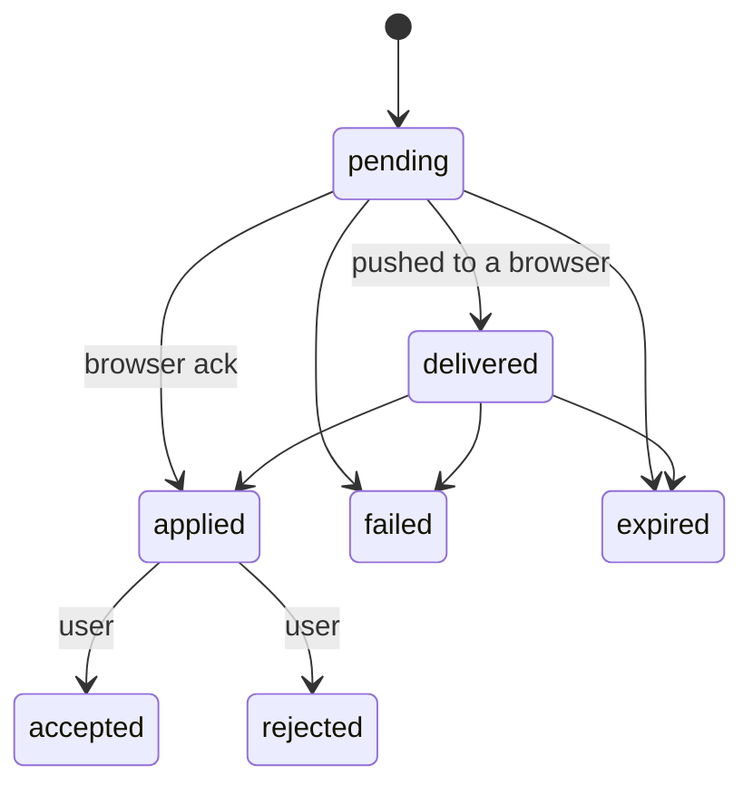
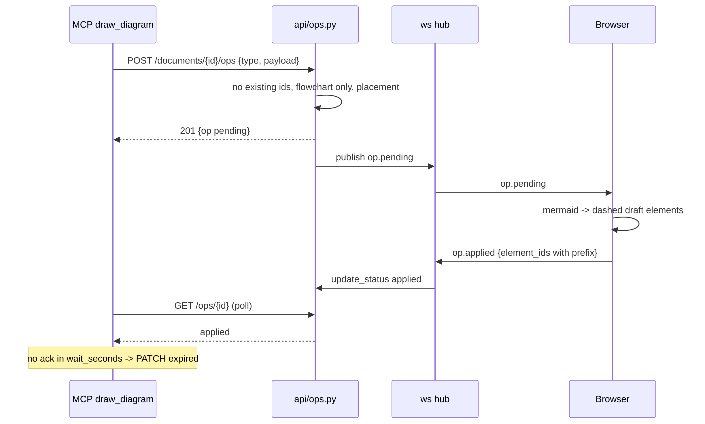
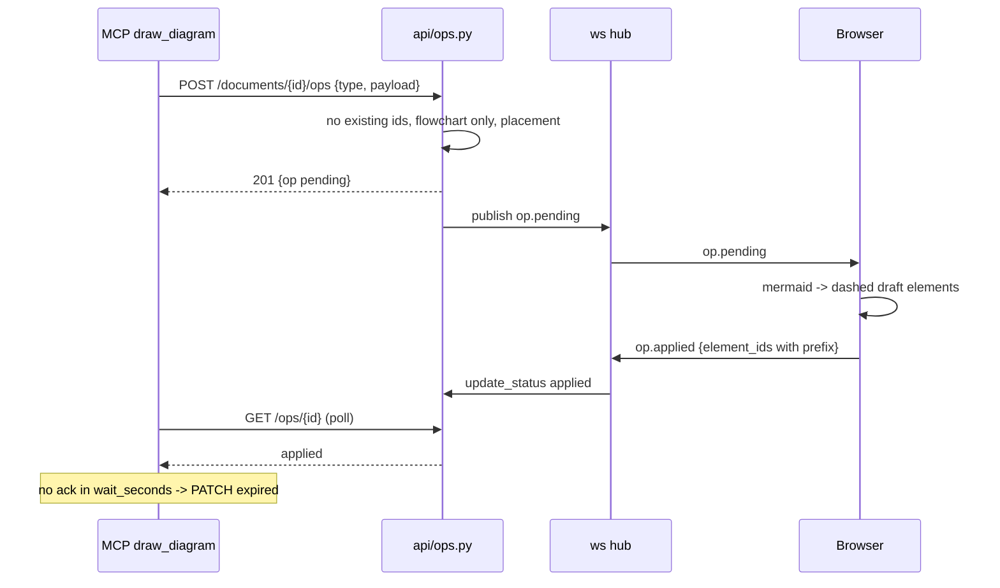

# Deep Dive: agent ops queue, placement, mermaid gate and WebSocket hub

> Snapshot written 26 Oct 2026; sections marked Updated 13 Nov 2026 were refreshed.

Files: `db/ops.py` (293 lines), `api/ops.py` (173), `api/ws.py` (205), `agent/placement.py` (84), `agent/mermaid.py` (28). Decisions 0009, 0012, 0023.

An **op** is an agent write: `write_text` or `draw_diagram`. Agents can only **add** elements; there is no edit or delete op type, so none can be expressed (`api/ops.py:41`).

## Drafts in the op row, placement and the new socket messages (Updated 13 Nov 2026)

The 26 Oct sections below describe a queue where the browser drew the draft into the scene and acked `op.applied`. Since INK-114 (decision 0086, migration 0011) the op row is the draft. Decisions 0086, 0090, 0094, 0100, 0115, 0116.

**Lifecycle.** `db/ops.py` `STATUSES` = `pending`, `delivered`, `placed`, `accepted`, `rejected`, `failed`, `expired`. Transitions: `pending` -> `delivered`, `failed`, `expired`; `delivered` -> `failed`, `expired`; `placed` -> `accepted`, `rejected`; `accepted` -> `placed` (unaccept). `placed`, `accepted` and the return trip are reachable only through `db/drafts.py`, never through `update_status`. `applied` no longer exists. Pending and delivered ops expire after 24 h (`OP_TTL_S`, decision 0049), swept lazily on create and list. Ops reserve their spot while `pending`, `delivered` or `placed` (`_RESERVING`).

**New columns** (migration 0011): `elements_json` (the measured draft), `box_json` (its placed box), `question_id`, `task_id`, `offer_id`, `revises` (op it revises), `diagram_id`, `resolved_at`. Payloads: `WriteTextPayload` (`text`, `anchor`, `size` hint, optional question link) and `DrawDiagramPayload` (`source` Mermaid or graph JSON, `source_kind` `mermaid` or `graph`, `anchor`, `from_chunks`, `diagram_id` set = a revision of that diagram; old `mermaid` payloads are read as `source`).

**Measure, place, accept** (`db/drafts.py`):
1. `measure_op` stores the elements the browser measured (`op.measured {op_id, elements, width, height}`), checks every id carries the op's `id_prefix` (`BadPrefix`, `IdCollision`, `ExistingElementIds`), places the draft with its true size via `agent/placement.py`, sets the op `placed` and the server pushes `op.placed {op_id, elements, placement, anchor}`.
2. `accept_op` is the one path allowed to write `<op_id>:` ids into the scene: in one transaction it merges the elements into `scene_elements` (`merge_elements` with `strict=False`, shifted by the drag offset), links the diagram object if any, and publishes `scene.delta`. A revision's accept replaces only untouched shapes of the earlier version (decision 0100). It is idempotent. `unaccept_op` raises `WindowClosed` after `UNACCEPT_WINDOW_S`, and always for a revision.
3. `reject_op` writes nothing to the scene. `unaccept_op` removes only elements the user has not touched since Accept.
4. Routes: `POST /ops/{id}/accept`, `/reject`, `/unaccept`, and `GET /documents/{id}/drafts`. `PATCH /ops/{id}` still handles failed and expired.

**Placement** (`agent/placement.py`, INK-116, decision 0094) is no longer "right of the anchor, then below". It searches candidate spots: `flow_spot` and `place` score positions near the anchor, avoiding occupied boxes, existing connectors (`connectors_of`, `_crosses`) and the visible viewport sent by `attention {pen, view}` (`view_rect`, `_inside_frac`). Font size comes from the handwriting scale (`font_size_for`, `line_pitch`; `DEFAULT_FONT` 28, `MIN_FONT` 18, `MAX_FONT` is only a sanity cap of 2000, decision 0045) and text wraps at `wrap_for(fs, view)`, sent as `payload.wrap_chars`. `gap_for` and `margin_for` scale the gaps with the font. Answer drafts get a flow arrow from the anchor (`agent/flow.py`, `isFlowArrow` on the client).

**WebSocket.** `api/ws.py` now sends `op.pending`, `op.placed`, `op.updated`, `op.error`, `chunks.updated`, `scene.delta {seq, origin, elements}` (not to the socket whose `device` is `origin`), `question.update`, `question.delta {id, seq, text}`, `offer.created` / `offer.updated` (only while the attention gate is open) and `agent.activity {working, what, count}`. The browser sends `attention {pen, view}`, `op.measured` and `op.failed`; `op.applied` is gone. On connect the server replays pending and delivered ops as `op.pending` and placed ops as `op.placed`.

**Tests.** `test_ops_api.py` (still the N1 guard: it must fail if the id check is removed), `test_ws.py`, `test_placement.py`, plus the draft and diagram tests (`ls server/tests | grep -i -E "draft|diagram|placement"`).

## Lifecycle, 26 Oct snapshot (`db/ops.py`)

Mermaid source

`_TRANSITIONS` encodes this. Repeating the current status is a no-op, except a repeated `applied` with a different id set raises `InvalidTransition` (`:252-256`). Anything else not in the table also raises, which the API maps to 409 `invalid_transition`.

## The no-edit invariant (N1)

Held on the server, not the client (`db/ops.py:1-12`):

1. **Payload check**: `referenced_existing_ids` collects every string anywhere in the payload, dict keys included (`_strings` is iterative, so any nesting depth), and intersects with the ids of the stored scene, deleted elements too. Any hit raises `ExistingElementIds` (422 `existing_element_id`). It runs before schema validation so an id is refused whichever field carries it (`api/ops.py:62-69`).
2. **Id prefix**: each op gets `id_prefix = "<op_id>:"` (`:80`). When the browser acks an applied op, every element id it reports must start with that prefix (`_check_new_ids`, `:272-276`); otherwise `ExistingElementIds`. Reject removes exactly an op's recorded ids, so a user element recorded as an op's would be deleted by a Reject; a prefix means a user element can only be claimed if the client renamed it. Op ids may not contain `:`, so no prefix is a prefix of another (`OpId` pattern `^[A-Za-z0-9_-]{1,64}$`).
3. At creation, scene ids already starting with the new op's prefix also refuse (`:165`).

Test: `server/tests/test_ops_api.py` (must fail if the check is removed).

## Creating an op (`_create_op`, `db/ops.py:138-207`)

Under `BEGIN IMMEDIATE` so two ops posted at once see each other's reserved spot:
1. Unknown document -> `DocumentNotFound`.
2. **Idempotency**: a client-chosen `op_id` that exists returns the stored op (status 200) if document, type and payload (minus `placement`, `id_prefix`) match, else `OpConflict` (409 `op_id_conflict`).
3. Cap: more than `MAX_OPEN_OPS = 200` pending or delivered ops on a canvas raises `TooManyOpen` (409).
4. Existing-id checks, then **anchor** lookup: `payload.anchor` is a chunk id on this canvas; missing or no bbox raises `AnchorNotFound` (422 `anchor_not_found`, with advice to call `read_canvas`).
5. **Placement**: occupied boxes = live scene elements (rotated about their centres) plus the reserved boxes of `pending`/`delivered`/`applied` ops; then `placement.place`.
6. Stored payload gains `placement` and `id_prefix`; status `pending`.

## Placement (`agent/placement.py`)

Pure. Sizes are estimates because the browser lays out text and Mermaid:
- text: `max line length x 0.6 x font_size` wide, `lines x 1.25 x font_size` tall;
- diagram: 600 x 400 scaled by `font_size / 20`.

**Font size** (decision 0032, `placement.font_size_for`, `db/ops.py` `_stroke_heights`): the median height of the user's freedraw strokes in the anchor chunk (all live strokes if fewer than 3 there), times `INK_TO_FONT = 1.5`, times the `size` hint (0.75 / 1 / 1.5), clamped to 18..64; fewer than 3 strokes gives 28. Stored as `payload.font_size`; clients cannot send it. Ops without it count as 20. Known issue: the 64 clamp can still make text small beside large handwriting (INK-082).
`place(occupied, size, anchor)`: try **right of the anchor** (`anchor.x + width + GAP(40)`, same top), then **below it**; use the first spot that does not overlap any occupied box within `MARGIN = 16`. Otherwise (and when there is no anchor) the fallback is the left edge of everything, below the lowest box plus `GAP` (the one position that can never overlap whatever the real size); an empty canvas gets `(0, 0)`. `rotated_box` expands a rotated element to its axis-aligned bound.

## Mermaid gate (`agent/mermaid.py`)

`diagram_type` strips a BOM, normalises newlines, removes YAML front matter and `%%{...}%%` directives (bounded to 2,000 characters so there is no slow backtracking), skips blank and `%%` comment lines, and returns the first keyword. `is_flowchart` accepts only `flowchart` and `graph`. Reason: `@excalidraw/mermaid-to-excalidraw` renders every other diagram kind as one image, which the user cannot edit. The API answers 422 `not_flowchart` with the detected type.

## Routes (`api/ops.py`)

| Route | Behaviour |
|---|---|
| `POST /documents/{id}/ops`, `POST /ops` (body `document_id`) | Validate, enqueue; 201 if created, 200 if an idempotent retry; publishes `op.pending` to open browsers |
| `GET /documents/{id}/ops?status=a,b` | List; unknown status 422; unknown document 404 |
| `GET /ops/{op_id}` | One op |
| `PATCH /ops/{op_id}` | Statuses `applied` (needs `element_ids`), `failed`, `expired`, `accepted`, `rejected`; publishes `op.updated` |

Schemas are strict (`extra="forbid"`): `WriteTextPayload` (1 to 10,000 characters, optional `anchor`), `DrawDiagramPayload` (1 to 20,000 characters, optional `anchor`).

## WebSocket hub (`api/ws.py`)

`WS /ws?document=<id>`:
- **Origin check** (`_same_origin`): browsers do not apply CORS to WebSockets, so a cross-origin page could read or ack ops. An `Origin` header must match the `Host` header (the Vite proxy keeps it); no Origin (scripts, tests) is allowed. Mismatch closes with 4403; unknown document closes with 4404.
- **Join then replay**: the socket joins the hub, then replays every `pending` and `delivered` op as `op.pending` and marks it delivered, so an op created in between is pushed at least once. The browser ignores a second copy of an op it already drew (ids carry the op prefix).
- **Incoming messages**: `op.applied {op_id, element_ids}` (1 to 10,000 ids of 1 to 256 characters, duplicates removed) and `op.failed {op_id, error}` (cut to 2,000). Errors reply `op.error` with `not_found`, `bad_ack`, `existing_element_id`, or `invalid_transition`; malformed frames reply `error`. An op from another document is `not_found`.
- **Hub** (`Hub`): sockets per document. `publish` is thread-safe: HTTP routes run in the threadpool, so it schedules the send on the event loop that owns the sockets with `run_coroutine_threadsafe`, and returns `None` if nobody is connected. `push_op` re-reads the op first (a PATCH may have made it `failed` or `expired` since) and marks it delivered once one socket got it. Dead sockets are dropped on send errors.
- Outgoing types: `op.pending`, `op.updated`, `op.error`, `chunks.updated` (from the worker), `question.update` (from the questions routes).

## Sequence: `draw_diagram`

Mermaid source

## Testing

`tests/test_ops_api.py` (existing ids refused in any field and for deleted elements, strict payloads, ack ids must carry the prefix, acks cannot claim user or other ops' elements, idempotent POST and re-ack, lifecycle and invalid transitions, persistence and replay, placement beside the anchor, no overlap, rotated ink, flowchart-only), `test_ws.py` (push within a second, replay on connect, acks and failures over the socket, other-document and bad-message handling, binary frames, cross-origin refusal), `test_placement.py`, `test_mermaid.py`, `test_mcp_write_text.py`, `test_mcp_draw_diagram.py`.

## Potential improvements

Accept/Reject is built in the browser ([web-ops-and-drafts](web-ops-and-drafts.md)); the server contract is unchanged. Open: undelivered `write_text` ops never expire (INK-088), drafts can land far apart (INK-077), agents can anchor to orphaned chunks (INK-084). `ops.create` is timed (`inkbridge.timing`). The 600 x 400 diagram estimate can overlap if Mermaid renders bigger; the below-everything fallback is only used when the right/below spots are taken.
