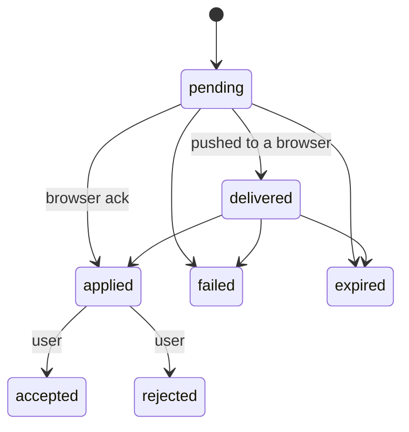
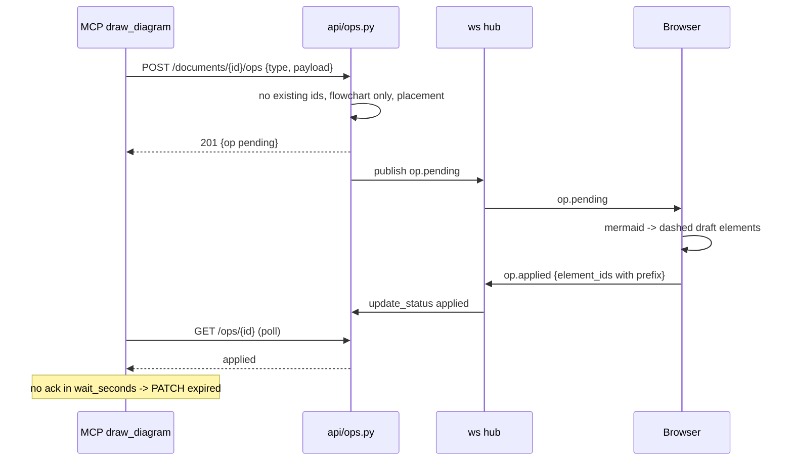

# Deep Dive: agent ops queue, placement, mermaid gate and WebSocket hub

Files: `db/ops.py` (293 lines), `api/ops.py` (173), `api/ws.py` (205), `placement.py` (84), `mermaid.py` (28). Decisions 0009, 0012, 0023.

An **op** is an agent write: `write_text` or `draw_diagram`. Agents can only **add** elements; there is no edit or delete op type, so none can be expressed (`api/ops.py:41`).

## Lifecycle (`db/ops.py:11, 24-31`)

`_TRANSITIONS` encodes this. Repeating the current status is a no-op, except a repeated `applied` with a different id set raises `InvalidTransition` (`:252-256`). Anything else not in the table also raises, which the API maps to 409 `invalid_transition`.

## The no-edit invariant (N1)

Held on the server, not the client (`db/ops.py:1-12`):

1. **Payload check**: `referenced_existing_ids` collects every string anywhere in the payload, dict keys included (`_strings` is iterative, so any nesting depth), and intersects with the ids of the stored scene, deleted elements too. Any hit raises `ExistingElementIds` (422 `existing_element_id`). It runs before schema validation so an id is refused whichever field carries it (`api/ops.py:62-69`).
2. **Id prefix**: each op gets `id_prefix = "<op_id>:"` (`:80`). When the browser acks an applied op, every element id it reports must start with that prefix (`_check_new_ids`, `:272-276`); otherwise `ExistingElementIds`. Reject removes exactly an op's recorded ids, so a user element recorded as an op's would be deleted by a Reject; a prefix means a user element can only be claimed if the client renamed it. Op ids may not contain `:`, so no prefix is a prefix of another (`OpId` pattern `^[A-Za-z0-9_-]{1,64}$`).
3. At creation, scene ids already starting with the new op's prefix also refuse (`:165`).

Test: `server/tests/test_ops_api.py` (must fail if the check is removed).

## Creating an op (`_create_op`, `db/ops.py:138-207`)

Under `BEGIN IMMEDIATE` so two ops posted at once see each other's reserved spot:
1. Unknown document -> `DocumentNotFound`.
2. **Idempotency**: a client-chosen `op_id` that exists returns the stored op (status 200) if document, type and payload (minus `placement`, `id_prefix`) match, else `OpConflict` (409 `op_id_conflict`).
3. Cap: more than `MAX_OPEN_OPS = 200` pending or delivered ops on a canvas raises `TooManyOpen` (409).
4. Existing-id checks, then **anchor** lookup: `payload.anchor` is a chunk id on this canvas; missing or no bbox raises `AnchorNotFound` (422 `anchor_not_found`, with advice to call `read_canvas`).
5. **Placement**: occupied boxes = live scene elements (rotated about their centres) plus the reserved boxes of `pending`/`delivered`/`applied` ops; then `placement.place`.
6. Stored payload gains `placement` and `id_prefix`; status `pending`.

## Placement (`placement.py`)

Pure. Sizes are estimates because the browser lays out text and Mermaid:
- text: `max line length x 12 px` wide (0.6 em at 20 px), `lines x 25 px` tall;
- diagram: fixed 600 x 400.
`place(occupied, size, anchor)`: try **right of the anchor** (`anchor.x + width + GAP(40)`, same top), then **below it**; use the first spot that does not overlap any occupied box within `MARGIN = 16`. Otherwise (and when there is no anchor) the fallback is the left edge of everything, below the lowest box plus `GAP` (the one position that can never overlap whatever the real size); an empty canvas gets `(0, 0)`. `rotated_box` expands a rotated element to its axis-aligned bound.

## Mermaid gate (`mermaid.py`)

`diagram_type` strips a BOM, normalises newlines, removes YAML front matter and `%%{...}%%` directives (bounded to 2,000 characters so there is no slow backtracking), skips blank and `%%` comment lines, and returns the first keyword. `is_flowchart` accepts only `flowchart` and `graph`. Reason: `@excalidraw/mermaid-to-excalidraw` renders every other diagram kind as one image, which the user cannot edit. The API answers 422 `not_flowchart` with the detected type.

## Routes (`api/ops.py`)

| Route | Behaviour |
|---|---|
| `POST /documents/{id}/ops`, `POST /ops` (body `document_id`) | Validate, enqueue; 201 if created, 200 if an idempotent retry; publishes `op.pending` to open browsers |
| `GET /documents/{id}/ops?status=a,b` | List; unknown status 422; unknown document 404 |
| `GET /ops/{op_id}` | One op |
| `PATCH /ops/{op_id}` | Statuses `applied` (needs `element_ids`), `failed`, `expired`, `accepted`, `rejected`; publishes `op.updated` |

Schemas are strict (`extra="forbid"`): `WriteTextPayload` (1 to 10,000 characters, optional `anchor`), `DrawDiagramPayload` (1 to 20,000 characters, optional `anchor`).

## WebSocket hub (`api/ws.py`)

`WS /ws?document=<id>`:
- **Origin check** (`_same_origin`): browsers do not apply CORS to WebSockets, so a cross-origin page could read or ack ops. An `Origin` header must match the `Host` header (the Vite proxy keeps it); no Origin (scripts, tests) is allowed. Mismatch closes with 4403; unknown document closes with 4404.
- **Join then replay**: the socket joins the hub, then replays every `pending` and `delivered` op as `op.pending` and marks it delivered, so an op created in between is pushed at least once. The browser ignores a second copy of an op it already drew (ids carry the op prefix).
- **Incoming messages**: `op.applied {op_id, element_ids}` (1 to 10,000 ids of 1 to 256 characters, duplicates removed) and `op.failed {op_id, error}` (cut to 2,000). Errors reply `op.error` with `not_found`, `bad_ack`, `existing_element_id`, or `invalid_transition`; malformed frames reply `error`. An op from another document is `not_found`.
- **Hub** (`Hub`): sockets per document. `publish` is thread-safe: HTTP routes run in the threadpool, so it schedules the send on the event loop that owns the sockets with `run_coroutine_threadsafe`, and returns `None` if nobody is connected. `push_op` re-reads the op first (a PATCH may have made it `failed` or `expired` since) and marks it delivered once one socket got it. Dead sockets are dropped on send errors.
- Outgoing types: `op.pending`, `op.updated`, `op.error`, `chunks.updated` (from the worker), `question.update` (planned).

## Sequence: `draw_diagram`

## Testing

`tests/test_ops_api.py` (existing ids refused in any field and for deleted elements, strict payloads, ack ids must carry the prefix, acks cannot claim user or other ops' elements, idempotent POST and re-ack, lifecycle and invalid transitions, persistence and replay, placement beside the anchor, no overlap, rotated ink, flowchart-only), `test_ws.py` (push within a second, replay on connect, acks and failures over the socket, other-document and bad-message handling, binary frames, cross-origin refusal), `test_placement.py`, `test_mermaid.py`, `test_mcp_write_text.py`, `test_mcp_draw_diagram.py`.

## Potential improvements

Accept/Reject has a server contract (`accepted`/`rejected` transitions) but no UI yet (INK-045). The 600 x 400 diagram estimate can overlap if Mermaid renders bigger; the below-everything fallback is only used when the right/below spots are taken.
