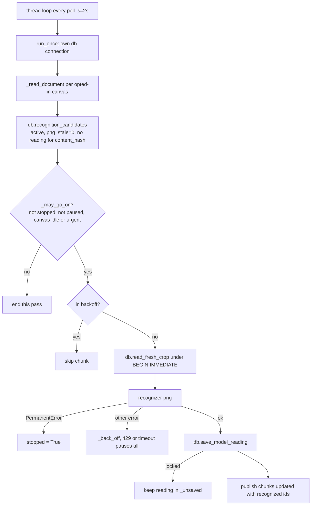

# Deep Dive: recognition (`recognizer/` and `recognition_worker.py`)

Recognition turns a chunk's crop PNG into text, LaTeX and a kind. It is a **cache in front of a model**: ink is the truth, a reading is keyed by `(region_id, content_hash, source)` (`recognitions` table). Moved or unchanged ink never triggers a model call because `content_hash` ignores position.

## Files

| File | Role |
|---|---|
| `recognizer/__init__.py` | `Recognition` dataclass (`text`, `latex`, `kind`, `model`), `Recognizer` protocol `(png, hint) -> Recognition`, the error hierarchy, `KINDS` |
| `recognizer/gemini.py` | `GeminiRecognizer`: prompt, spacing, retries, parsing, transport |
| `recognition_worker.py` | `RecognitionWorker`: the background thread and its rules |

There is deliberately no module-level `recognize()`. The only caller is the opt-in worker, which owns the privacy gate (decision 0017).

## Error hierarchy (`recognizer/__init__.py:23-49`)

`RecognizerError` is the base; the worker retries these with backoff. `PermanentError` (`MissingApiKey`, `InvalidApiKey`) stops the worker. `RateLimited` (429), `RecognizerTimeout` and `BadResponse` are transient.

## GeminiRecognizer (`gemini.py`)

- **Model**: `GEMINI_MODEL` or `gemini-3.5-flash-lite` (`:23`); key from `GEMINI_API_KEY`. With no key and no injected transport it raises `MissingApiKey` (`:54-55`). `__repr__` never includes the key (`:63`).
- **Prompt** (`:25-30`): transcribe, reply with JSON `{text, latex, kind}` where kind is one of handwriting, equation, diagram, mixed, no commentary. An optional hint is appended as "Context hint".
- **Calls are serialised** by a lock (`:68`) and spaced by `min_interval = 4.0` s (`_space_calls`, `:88`) to stay inside free-tier limits.
- **Retries** (`_send`, `:72-86`): only `RateLimited` retries, up to `max_retries = 3`, sleeping `backoff x 2^attempt` (2, 4, 8 s). Any other `RecognizerError` fails at once. Error messages are redacted (`_redact` replaces the key with `***`) and re-raised outside the `except` block so no chained context keeps the raw message.
- **Parsing** (`_parse`, `:98-119`): strips ```` ```json ```` fences, parses JSON, accepts a list of objects (joined by newlines), requires a string `text` in each; `latex` values are joined; `kind` is lower-cased, aliased (`text` -> handwriting, `math` -> equation) and falls back to `mixed`. Bad JSON or a missing `text` raises `BadResponse`.
- **Transport** (`_google_transport`, `:121-152`): `google-genai` client with `response_mime_type="application/json"`. Mapping: 429 -> `RateLimited`; 401/403 or 400 "api key not valid" -> `InvalidApiKey`; 408/504 or any timeout-looking exception -> `RecognizerTimeout`; anything else -> `RecognizerError` with the code.
- `default_recognizer()` builds one shared instance under a lock.

Tests inject a `transport` callable so nothing goes to the network (`tests/test_recognizer.py`).

## RecognitionWorker (`recognition_worker.py`)



### Construction (`from_env`, `:68-91`)

Reads `INKBRIDGE_RECOGNIZE_DOCUMENTS` (comma list; empty returns `None`, so the worker is off), `INKBRIDGE_RECOGNIZE_IDLE_S` (default 5; a bad number logs a warning). A missing key or SDK logs a warning and returns `None`: it never raises, so the API still starts.

### Timing and state

- `idle_s = 5`, `poll_s = 2`, `backoff_s = 30`, `backoff_max_s = 600`.
- `_idle` compares `now - documents.updated_at` to `idle_s`, so a canvas that is being saved is left alone; drawing never waits on this thread.
- `_may_go_on` is checked **before every chunk**: not stopped, not fatal, not paused, and idle (the idle delay is skipped for an urgent chunk).
- State: `_failures[(region, hash)] = (count, retry_at)`, `_unsaved` (readings whose save hit a locked database, kept so no new model call is needed), `_paused_until` (global pause), `_urgent[doc][region] = expiry`.
- Stale entries are dropped each pass when their key no longer appears among candidates (ink changed or chunk gone, `:189-192`).

### Backoff (`_back_off`, `:249-262`)

Delay doubles per failure: `min(30 x 2^(n-1), 600)`. For `RateLimited` and `RecognizerTimeout` the whole worker pauses until the same time, because trying the next chunk would hit the same provider problem.

### Urgent requests (`request`, `:139-162`)

Used by `check_sync`. Returns the region ids it will try: none if the canvas is not opted in, the worker is stopped or not alive, or calls are paused; ids still in backoff are excluded. Accepted ids get an expiry (`ttl_s`, default 60) and are sorted first in the candidate list (`:194`). `_wake` is set so the thread skips the rest of its poll sleep.

### Races handled

- `db.read_fresh_crop` re-checks, under `BEGIN IMMEDIATE` (the same lock crop uploads take), that the region is still active with that content hash and a fresh crop before the bytes are read (`db/__init__.py:909-929`). The candidate list can be seconds old because each model call takes time.
- A locked database on read or save is logged and retried on the next pass (`sqlite3.OperationalError`); the reading is not lost.
- `publish` (wired to the WebSocket hub) sends `chunks.updated` with `recognized` ids, the scene version and the stale-crop ids.

### One process only

Each API process would start its own worker (decision 0017). Run one.

## Privacy

Gemini free tier may train on content. Nothing is read unless the canvas id is in `INKBRIDGE_RECOGNIZE_DOCUMENTS`; keep personal canvases out. Real notes are read by Claude through `read_canvas` and `get_region`.

## Testing

`tests/test_recognizer.py` (parsing, retries, redaction, spacing with injected clock and sleep) and `tests/test_recognition_worker.py` (about 45 tests: zero calls on a second run or after a move, one call after an edit, source precedence, stale or missing crops skipped, idle wait, only listed canvases, orphans skipped, backoff and a global pause on 429, permanent error stops the worker, locked database keeps the reading, ink edited during a call is not read under its old hash, urgent requests and their TTL, `from_env` never raising, and that the worker never imports the API).

## Potential improvements

- A hint is accepted by the recognizer but the worker always passes `None`.
- `min_interval` is a per-process pacing; two processes would double the rate.
